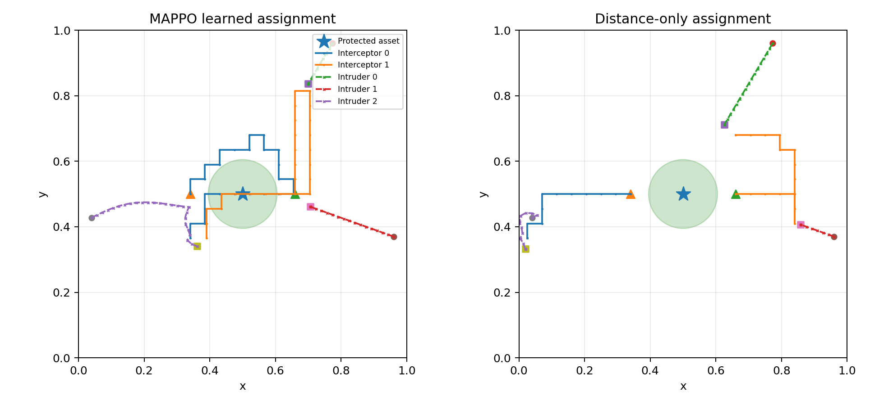
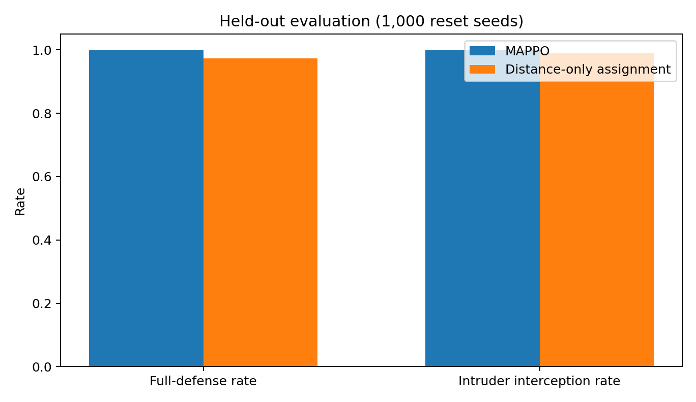
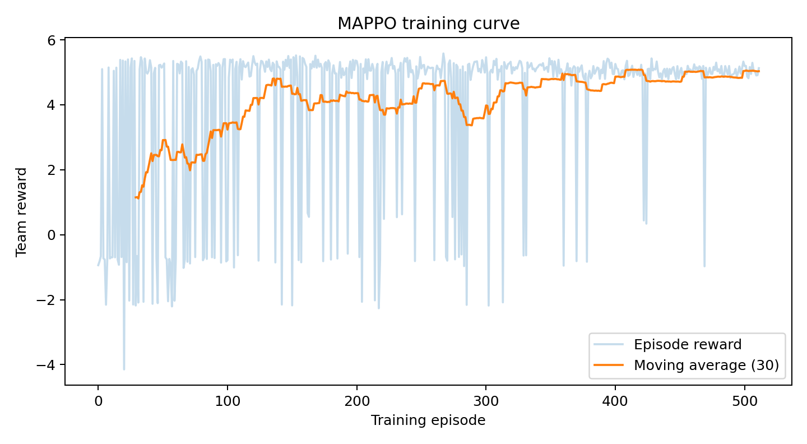

# Decentralized Swarm Interception with MAPPO

A compact PyTorch research prototype exploring **decentralized interceptor-to-intruder target assignment** in a simplified 2D swarm-interception environment. The project is inspired by the research problem described in the ENSTA U2IS internship proposal *Countering Coordinated Drone Swarms with Decentralized MARL*; it is an independent prototype and is not an official ENSTA project.

> **Scope:** this is a toy 2D environment, not a drone flight simulator. MAPPO learns target selection. A deterministic local pursuit controller converts the selected target into a simple movement command, so low-level movement is **not learned** in this version.

## At a glance

- **Agents:** 2 interceptors against 3 intruders.
- **Learning method:** Multi-Agent Proximal Policy Optimization (MAPPO), implemented in PyTorch.
- **Architecture:** shared decentralized actor + centralized critic (CTDE).
- **Coordination signal:** each interceptor receives a one-hot message representing its teammate's previous target intention.
- **Baseline:** receding-horizon, minimum-total-distance one-to-one target assignment.
- **Experiment:** 512 training episodes and 1,000 held-out evaluation episodes.

## Visual results

### Example interception trajectories

The panels compare one representative held-out rollout using the learned MAPPO assignment policy and the distance-only assignment baseline. The protected asset is shown as a star; solid paths are interceptors and dashed paths are intruders.



### Held-out evaluation comparison

Across 1,000 held-out reset seeds, the learned assignment policy achieved a higher full-defense rate and intruder interception rate in this fixed test configuration. The distance-based baseline completed interceptions faster on average (see the table below).



### Training curve

The plot shows per-episode team reward and a 30-episode moving average over 512 training episodes.



## Experimental results

**Configuration:** 2 interceptors, 3 intruders, 512 MAPPO training episodes, random seed `7`. Evaluation used 1,000 held-out reset seeds (`900000`–`900999`), shared by MAPPO and the baseline.

| Metric | MAPPO learned assignment | Distance-only assignment baseline |
|---|---:|---:|
| Full-defense rate (all intruders intercepted) | **99.9%** | 97.3% |
| Intruder interception rate | **99.97%** | 99.10% |
| Mean intruders captured per episode | 2.999 | 2.973 |
| Mean intruders reaching protected area | 0.001 | 0.027 |
| Mean time to capture (steps) | 16.21 | **11.86** |
| Mean episode length (steps) | 26.04 | **18.48** |

In this experiment, MAPPO achieved slightly higher full-defense and interception rates, while the distance-only baseline was faster on average. These results apply only to this simplified environment and this training configuration. They are **not** evidence of generalization to larger teams, unseen opponent strategies, realistic dynamics, or physical drones.

The exact metrics are saved in [`results/metrics.json`](results/metrics.json). The plots and training artifacts are in [`results/`](results/). A concise project summary is available in [`PROJECT_BRIEF.pdf`](PROJECT_BRIEF.pdf) and [`PROJECT_BRIEF.md`](PROJECT_BRIEF.md).

## What is implemented

- **Environment:** two interceptors defend a protected asset against three intruders in a normalized 2D arena. Motion uses simplified kinematics.
- **Intruder behaviours:** scripted direct-approach, split/lane-approach, and decoy/evasive behaviours. These provide different scenarios without yet training an adversarial intruder team.
- **Limited sensing:** each interceptor receives relative positions only for intruders inside its sensing radius.
- **Decentralized actor:** one shared actor is applied independently to each interceptor. Its observation includes its own position, relative teammate position, visible intruder-relative positions, visibility indicators, and a one-hot message encoding the teammate's previous target intention.
- **Centralized critic:** during training, the critic receives the global state: both interceptor positions, all intruder positions, and intruder-alive flags. This follows the **centralized training / decentralized execution (CTDE)** paradigm.
- **MAPPO:** clipped PPO objective, generalized advantage estimation (GAE), shared team reward, and a centralized value function.
- **Pursuit controller:** after an interceptor selects a target, a deterministic local rule selects the cardinal movement that most reduces the relative target displacement. This isolates the learned target-assignment component.
- **Assignment baseline:** at each step, an exact minimum-cost one-to-one allocation is selected by enumerating the possible assignments and minimizing total Euclidean distance. It uses the same pursuit controller as MAPPO.
- **Evaluation:** full-defense rate, intruder interception rate, mean captures and leaks, time to capture, and episode length.

## Run the experiment

Python 3.10+ is recommended.

```bash
python -m venv .venv

# Linux / macOS
source .venv/bin/activate

# Windows PowerShell
# .venv\Scripts\Activate.ps1

pip install -r requirements.txt
python train.py --episodes 512 --eval-episodes 1000 --seed 7 --output results
```

The run saves:

- `mappo_actor_critic.pt` — trained shared actor and centralized critic
- `metrics.json` — evaluation metrics
- `training_history.npz` — episode rewards, captures, and leaks
- `training_curve.png` — training reward curve
- `evaluation_comparison.png` — MAPPO versus assignment-baseline comparison
- `trajectory_comparison.png` — representative held-out rollout trajectories

You can also open [`MAPPO_Swarm_Interception.ipynb`](MAPPO_Swarm_Interception.ipynb) to inspect and run the experiment step by step. Run the smoke tests with:

```bash
python -m pytest -q
```

## Project structure

```text
.
├── MAPPO_Swarm_Interception.ipynb
├── README.md
├── PROJECT_BRIEF.md
├── PROJECT_BRIEF.pdf
├── requirements.txt
├── train.py
├── src/
│   ├── __init__.py
│   ├── swarm_env.py
│   ├── mappo.py
│   └── evaluation.py
├── tests/
│   └── test_smoke.py
└── results/
    ├── metrics.json
    ├── training_history.npz
    ├── mappo_actor_critic.pt
    ├── training_curve.png
    ├── evaluation_comparison.png
    └── trajectory_comparison.png
```

## Limitations and next steps

This prototype deliberately focuses on the target-assignment subproblem. It does **not** yet implement:

- continuous flight dynamics or acceleration/turn-rate constraints;
- collision avoidance or realistic sensing noise;
- a learned low-level guidance controller;
- an attention/pointer mechanism for variable-sized target sets;
- GPU-vectorized simulation or a JAX implementation;
- ROS 2, Gazebo, or PX4 integration;
- a learned intruder team or competitive self-play.

Natural next steps toward a more complete research system are:

1. Replace the cardinal pursuit rule with a learned guidance policy or continuous-control action space.
2. Add an attention/pointer mechanism over a variable-sized set of observed intruders and teammate intentions.
3. Vary the number of interceptors and intruders, including systematic `N < M` experiments.
4. Vectorize the simulator and investigate a JAX implementation.
5. Replace scripted intruders with a second learned team and study competitive self-play and opponent populations.
6. Validate the approach in a higher-fidelity simulator before making claims about physical drone operation.

## Reproducibility and interpretation

The reported metrics are stored in `results/metrics.json`. Training uses seed `7`; the 1,000 evaluation seeds (`900000`–`900999`) are held out and shared between the two evaluated policies. Intruder behaviours and movement rules are scripted and deterministic for a given reset; variation between evaluation episodes comes primarily from randomized spawn positions. Results may change with hyperparameters, initialization, or environment modifications.
